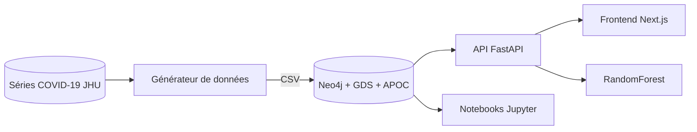

# EpiGraph

Tableau de bord d'analyse épidémiologique reposant sur une base de données graphe Neo4j, avec une API FastAPI, un frontend Next.js et des notebooks d'exploration.

## Problème traité

Le suivi d'une épidémie repose sur des relations : qui a contaminé qui, dans quel lieu, quel hôpital a pris en charge quel patient. Ces chaînes sont naturellement un graphe. Le projet modélise ces données dans Neo4j, y applique des algorithmes de graphes (Graph Data Science) et expose les résultats via une API et un tableau de bord. Il sert aussi de support de comparaison entre une approche relationnelle (SQL) et une approche graphe (notebook `06`).

Les données sont **synthétiques** : elles sont produites par un générateur qui part des séries COVID-19 du dépôt Johns Hopkins (CSSE) et simule les patients, les événements et la propagation (modèle de type SEIR).

## Fonctionnalités

- Générateur de jeu de données (CSV) : lieux, hôpitaux, patients, maladies, vaccins, événements, chaînes d'infection et relations associées. Graine fixe (`SEED=42`) pour la reproductibilité.
- Import automatique dans Neo4j au démarrage du conteneur (contraintes, nœuds, relations) via des scripts Cypher.
- API REST (FastAPI) : patients et contacts, chaînes d'infection, super-propagateurs, chronologie, répartition par variant et par lieu, communautés, PageRank, centralité, plus court chemin, similarité, hôpitaux (capacité, saturation, transferts).
- Prédiction de risque par patient (RandomForest scikit-learn) à partir de variables extraites du graphe, et endpoint de prévision.
- Frontend Next.js : pages dashboard, contact tracing, clusters, chronologie, prédictions, hôpitaux ; graphes 3D (react-force-graph), cartes (Leaflet) et graphiques (Recharts, D3).
- Six notebooks Jupyter : exploration, bases de Cypher, algorithmes GDS, entraînement ML, visualisation, comparaison SQL / Neo4j.

## Architecture



Modèle de graphe (relations utilisées par l'API) : `INFECTED_BY`, `LIVES_IN`, `LOCATED_IN`, `HAS_DISEASE`, `TREATED_AT`, `VACCINATED_WITH`. Détails dans [docs/ARCHITECTURE.md](docs/ARCHITECTURE.md).

## Stack technique

| Couche | Technologies |
|---|---|
| Base de données | Neo4j 5.15 (édition Enterprise, plugins GDS et APOC), Cypher |
| Backend | Python 3.11, FastAPI, Pydantic, driver Neo4j |
| Machine learning | scikit-learn, pandas, numpy, joblib |
| Génération de données | Python, pandas, numpy |
| Frontend | Next.js 14, React 18, TypeScript, Tailwind CSS, Recharts, D3, Leaflet, react-force-graph-3d |
| Notebooks | Jupyter (image `jupyter/scipy-notebook`) |
| Orchestration | Docker, Docker Compose |

## Installation

Prérequis : Docker et Docker Compose, environ 8 Go de RAM disponibles, accès Internet (images Docker et téléchargement des séries JHU). L'image Neo4j utilisée est l'édition Enterprise, dont la licence est acceptée via `NEO4J_ACCEPT_LICENSE_AGREEMENT=yes` dans la configuration ; vérifier que cet usage est conforme à vos conditions.

```bash
git clone <url-du-depot> epigraph
cd epigraph

# 1. Variables d'environnement (remplacer les valeurs factices)
cp .env.example .env

# 2. Générer les CSV dans data/csv/
docker compose run --rm data-generator

# 3. Démarrer les services (l'import dans Neo4j se lance au démarrage)
docker compose up -d --build
docker compose ps
```

Si le téléchargement des séries JHU échoue, le générateur utilise un jeu de repli de 30 régions (France, Espagne, Italie).

Un script PowerShell (`scripts/epigraph.ps1`) automatise ces étapes sous Windows et lit les identifiants dans `.env`.

## Utilisation

| Service | URL |
|---|---|
| Frontend | http://localhost:3000 |
| API (Swagger) | http://localhost:8000/docs |
| Neo4j Browser | http://localhost:7474 |
| Jupyter | http://localhost:8888 (jeton : `JUPYTER_TOKEN`) |

Exemples d'appels :

```bash
curl http://localhost:8000/api/patients/stats
curl http://localhost:8000/api/infections/superspreaders
curl "http://localhost:8000/api/analytics/pagerank"
curl http://localhost:8000/api/predictions/model-info
```

Entraînement du modèle de risque (après import des données) :

```bash
docker compose exec backend python train_model.py
```

Les projections GDS (`neo4j/scripts/04_projections.cypher`) et les contrôles (`05_validation.cypher`) se lancent depuis Neo4j Browser. Autres documents : [démarrage rapide](docs/QUICKSTART.md), [référence Cypher](docs/CYPHER_REFERENCE.md), [modèles ML](docs/ML_MODELS.md), [FAQ](docs/FAQ.md).

## Structure du dépôt

```
backend/            API FastAPI (app/routers, app/services, app/ml), train_model.py, tests/
frontend/           Application Next.js (src/app, src/components, src/lib)
neo4j/              Dockerfile, configuration et scripts Cypher d'import (scripts/)
data/scripts/       Générateur de données synthétiques
data/csv/           Sortie du générateur (non versionnée)
notebooks/          Notebooks Jupyter 01 à 06
scripts/            Script PowerShell de lancement (Windows)
docs/               Architecture, démarrage rapide, Cypher, ML, FAQ
.env.example        Variables d'environnement factices
docker-compose.yml  Orchestration des 5 services
```

## Tests

Tests unitaires du prédicteur de risque (sans connexion Neo4j) :

```bash
cd backend
pip install -r requirements-dev.txt
python -m pytest tests
```

Il n'y a pas de tests automatisés pour les routes de l'API, les scripts Cypher ni le frontend.

## Limites connues

- Données synthétiques : les résultats ne décrivent aucune situation réelle et ne doivent pas servir à une décision sanitaire.
- Le score de précision affiché à l'entraînement est calculé sur les données d'entraînement, sans jeu de test séparé ; il ne mesure pas la généralisation.
- Les étiquettes d'entraînement sont dérivées du graphe simulé, donc du même processus que celui qui a produit les données.
- Neo4j nécessite l'édition Enterprise (image utilisée) ; les plugins GDS et APOC sont téléchargés au premier démarrage.
- Aucune authentification sur l'API : usage local uniquement.

## Licence

Licence : tous droits réservés. Voir le fichier [LICENSE](LICENSE).

## Contact

Jean-Paul ADOGLI, étudiant ingénieur en data science et big data, GitHub : [Jean-Paul15](https://github.com/Jean-Paul15).
