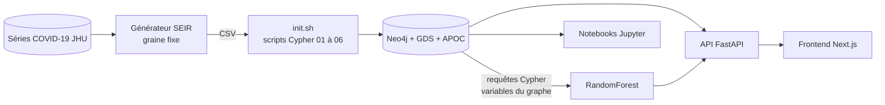

# EpiGraph

Qui a contaminé qui, où, et quel hôpital a fini par en payer le prix ? EpiGraph répond à ces questions en suivant les chaînes d'infection comme un graphe Neo4j, de la simulation des données jusqu'au tableau de bord.

## Ce que ça apporte

- **Une chaîne complète, reproductible.** Un générateur à graine fixe (`SEED=42`) part des séries COVID-19 Johns Hopkins, simule la propagation (modèle de type SEIR) sur 60 jours pour cinq pays, et produit des CSV. Docker Compose orchestre cinq services, l'import dans Neo4j démarre seul.
- **Des algorithmes de graphes derrière une API.** Communautés (Louvain), PageRank, centralité, plus court chemin, similarité et super-propagateurs sont exposés par FastAPI sous `/api/analytics` et `/api/infections`. Une projection GDS `epidemic-network` est créée à la demande.
- **Un modèle de risque nourri par le graphe.** Les variables d'un RandomForest (âge, comorbidités, vaccination, densité locale, nombre de contacts) sont extraites par des requêtes Cypher, puis servies par `/api/predictions`.

## Le problème

Une épidémie, ce sont des liens : un patient en contamine trois, l'un d'eux travaille dans un hôpital saturé, un autre voyage vers une autre région. Dans un tableau SQL, remonter une chaîne de contamination sur quatre niveaux demande des jointures en cascade. Dans un graphe, c'est un seul chemin à parcourir. EpiGraph modélise ces données dans Neo4j, applique les algorithmes de Graph Data Science et les rend visibles. Il sert aussi de terrain de comparaison entre SQL et graphe, dans le notebook `06_sql_comparison.ipynb`.

Les données sont synthétiques. Aucune donnée de patient réel n'entre dans le dépôt.

## Démarrer en cinq minutes

Prérequis : Docker avec Compose, environ 8 Go de RAM, un accès Internet. Le dossier `.env` se crée à partir de `.env.example`, dont les valeurs sont factices : remplacez-les.

```bash
cp .env.example .env
docker compose run --rm data-generator
docker compose up -d --build
docker compose ps
curl http://localhost:8000/api/infections/superspreaders
```

Le tableau de bord ouvre sur http://localhost:3000. La documentation Swagger de l'API est sur http://localhost:8000/docs, Neo4j Browser sur http://localhost:7474, Jupyter sur http://localhost:8888 (jeton : `JUPYTER_TOKEN`).

Si le téléchargement des séries JHU échoue, le générateur bascule sur un jeu de repli de 30 régions. Sous Windows, `scripts/epigraph.ps1` (commandes `start`, `stop`, `restart`, `destroy`, `status`, `logs`) enchaîne ces étapes. Détails dans [docs/QUICKSTART.md](docs/QUICKSTART.md).

## Comment ça marche



Trois choix structurent le projet.

**Le graphe comme source unique.** Les relations `INFECTED_BY`, `LIVES_IN`, `LOCATED_IN`, `HAS_DISEASE`, `TREATED_AT` et `VACCINATED_WITH` portent tout le modèle. L'API, le modèle de risque et les notebooks interrogent la même base, sans copie intermédiaire. Voir [docs/ARCHITECTURE.md](docs/ARCHITECTURE.md).

**Un import idempotent au démarrage.** `neo4j/scripts/init.sh` attend que Neo4j réponde, compte les nœuds, et ignore l'import si la base est déjà remplie. Un `docker compose up` répété ne duplique rien. Les contraintes passent en premier, puis les nœuds, puis les relations.

**Un modèle entraîné au premier lancement.** `backend/start.sh` attend Neo4j, entraîne le modèle s'il n'existe pas dans `backend/models/`, puis lance Uvicorn. L'API répond avec un modèle prêt, sans étape manuelle. Le réentraînement se fait avec `docker compose exec backend python train_model.py`.

## Stack

| Couche | Technologies |
|---|---|
| Base de données | Neo4j 5.15 (édition Enterprise, plugins GDS et APOC), Cypher |
| Backend | Python 3.11, FastAPI, Pydantic, driver Neo4j |
| Machine learning | scikit-learn, pandas, numpy, joblib |
| Génération de données | Python, pandas, numpy |
| Frontend | Next.js 14, React 18, TypeScript, Tailwind CSS, Recharts, D3, Leaflet, react-force-graph-3d |
| Notebooks | Jupyter (image `jupyter/scipy-notebook`) |
| Orchestration | Docker, Docker Compose |

L'image Neo4j est l'édition Enterprise, acceptée via `NEO4J_ACCEPT_LICENSE_AGREEMENT=yes` dans la configuration. Vérifiez que cet usage est conforme à vos conditions.

## Structure du dépôt

```
backend/            API FastAPI (app/routers, app/services, app/ml), train_model.py, tests/
frontend/           Application Next.js (src/app, src/components, src/lib)
neo4j/              Dockerfile, configuration et scripts Cypher d'import (scripts/)
data/scripts/       Générateur de données synthétiques
data/csv/           Sortie du générateur (non versionnée)
notebooks/          Six notebooks Jupyter, de l'exploration à la comparaison SQL / Neo4j
scripts/            Script PowerShell de lancement (Windows)
docs/               Architecture, démarrage rapide, Cypher, ML, FAQ
.env.example        Variables d'environnement factices
docker-compose.yml  Orchestration des 5 services
```

Les tests du prédicteur de risque tournent sans Neo4j :

```bash
cd backend && pip install -r requirements-dev.txt && python -m pytest tests
```

## Limites et suite

Le périmètre est un choix : EpiGraph démontre une chaîne de bout en bout sur des données simulées, pas un outil de décision sanitaire.

- **Données synthétiques.** Les résultats ne décrivent aucune situation réelle. C'est ce qui permet de publier le projet et de le rejouer à l'identique.
- **Précision d'entraînement.** Le score affiché est calculé sur les données d'entraînement, sans jeu de test séparé. Il ne mesure pas la généralisation. Les étiquettes viennent du graphe simulé, donc du processus qui a produit les données.
- **Prévision simple.** `/api/predictions/forecast` extrapole une moyenne mobile sur sept jours et sa tendance. Ce n'est pas un modèle épidémiologique.
- **Usage local.** L'API n'a pas d'authentification. Les tests couvrent le prédicteur, pas les routes, les scripts Cypher ni le frontend.

Suite naturelle : un jeu de test séparé pour le modèle, des tests de routes sur une base Neo4j jetable, une authentification sur l'API.

## Licence

Tous droits réservés. Voir [LICENSE](LICENSE). La lecture du code à des fins d'évaluation est permise.

## Contact

Jean-Paul ADOGLI, étudiant ingénieur en data science et big data. GitHub : [Jean-Paul15](https://github.com/Jean-Paul15).
